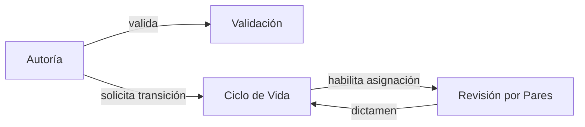
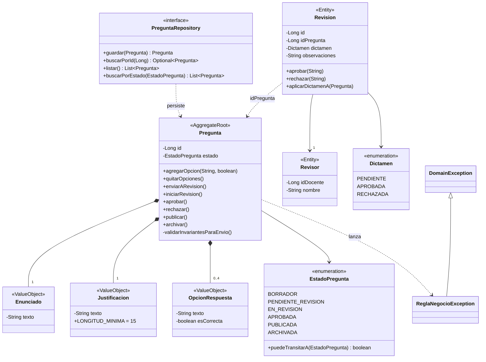

# Taller 11 — Domain-Driven Design (DDD)

Modelado estratégico y táctico del Banco de Preguntas Saber Pro · Laboratorio de Ingeniería de Software II · Universidad del Cauca · 2026.2

## Tecnologías

- Java 17+ puro, **sin Spring ni JPA**
- Maven
- JUnit 5 (única dependencia, solo para pruebas)

## Estructura de paquetes

```
co.edu.unicauca.saberpro.domain/
├── model/          # Agregado, entidades, objetos de valor y enums
├── exception/      # Excepciones de negocio
└── repository/     # Interfaces de repositorio (puras)
```

## Modelado estratégico

Bounded Contexts, lenguaje ubicuo y mapa de contextos: [docs/modelado-estrategico.md](docs/modelado-estrategico.md).



## Modelado táctico

| Bloque DDD | Clases |
|---|---|
| Raíz de agregado | `Pregunta` |
| Objetos de valor (inmutables) | `Enunciado`, `Justificacion`, `OpcionRespuesta` |
| Entidades | `Revisor` (id de docente), `Revision` (id de evaluación) |
| Enums | `EstadoPregunta`, `Dictamen` |
| Excepciones | `DomainException`, `ReglaNegocioException` |
| Repositorio | `PreguntaRepository` (interfaz pura) |

**Invariantes del agregado:**

- Las opciones y el contenido solo cambian en estado `BORRADOR`.
- Máximo 4 opciones y sin repetirse.
- Para enviar a revisión: enunciado, justificación, **exactamente 4 opciones y exactamente 1 clave**.
- Justificación de al menos 15 caracteres y sin expresiones prohibidas (`obviamente`, `es evidente`, `todas las anteriores`…).
- Las transiciones de estado siguen `EstadoPregunta.puedeTransitarA`.
- Una `Revision` emite un único dictamen, y un rechazo exige observaciones.

### Diagrama de clases del dominio



## Pruebas

```bash
mvn test
```
