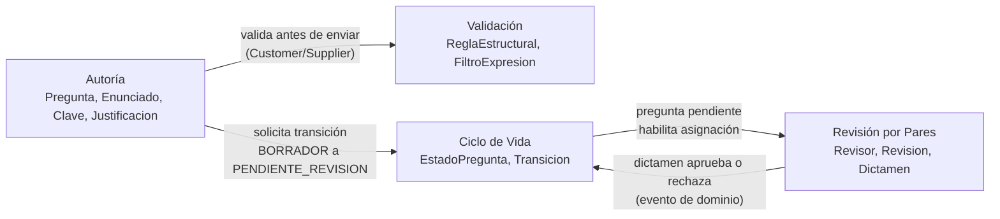

# Parte I — Modelado estratégico

## Bounded Contexts y Lenguaje Ubicuo

El Banco de Preguntas Saber Pro se descompone en cuatro contextos delimitados. Cada uno tiene su propio modelo y su propio vocabulario: una misma palabra puede tener matices distintos según el contexto (por ejemplo, para Autoría una *Pregunta* es contenido que se redacta, y para Ciclo de Vida es algo que tiene un estado).

| Bounded Context | Responsabilidad principal | Lenguaje Ubicuo |
|---|---|---|
| **Autoría** | Gestión de reactivos (Diseño Centrado en Evidencia): enunciados, opciones, distractores y justificaciones | Pregunta, Enunciado, Clave, Distractor, Justificacion, Autor |
| **Validación** | Verificación de las reglas de calidad estructural y pedagógica antes de enviar a revisión | ReglaEstructural, FiltroExpresion, ValidezOpciones |
| **Ciclo de Vida** | Control estricto de los estados de la pregunta y de las transiciones permitidas | EstadoPregunta, Transicion, Borrador, PendienteRevision, EnRevision, Aprobada, Publicada |
| **Revisión por Pares** | Asignación de evaluadores, emisión de dictámenes y observaciones pedagógicas | Revisor, Asignacion, Evaluacion (Revision), Dictamen, Observacion |

### Glosario

- **Pregunta (reactivo):** ítem de evaluación compuesto por un enunciado, cuatro opciones y una justificación. Es la raíz del agregado.
- **Enunciado:** texto que plantea el problema al estudiante. No puede estar vacío.
- **Clave:** la única opción correcta.
- **Distractor:** opción incorrecta pero plausible.
- **Justificación:** explicación de por qué la clave es correcta. Mínimo 15 caracteres y sin expresiones prohibidas.
- **Borrador / Pendiente de revisión / En revisión / Aprobada / Publicada / Archivada:** estados del ciclo de vida.
- **Revisor:** docente que evalúa una pregunta asignada.
- **Dictamen:** resultado de una revisión (aprobada o rechazada), con observaciones.

## Mapa de contextos

**Relaciones:**

- **Autoría → Validación (Customer/Supplier):** Autoría es el cliente; usa las reglas de Validación antes de permitir el envío a revisión. En el código esto se concreta en las invariantes del agregado `Pregunta` (exactamente 4 opciones y 1 clave) y en los objetos de valor (`Justificacion`, `Enunciado`).
- **Autoría → Ciclo de Vida:** Autoría no cambia el estado directamente. Pide la transición (`enviarARevision()`) y Ciclo de Vida decide si es válida (`EstadoPregunta.puedeTransitarA`).
- **Ciclo de Vida → Revisión por Pares:** solo las preguntas en `PENDIENTE_REVISION` pueden asignarse a revisores.
- **Revisión por Pares → Ciclo de Vida:** el dictamen de una `Revision` (aprobada o rechazada) produce la transición correspondiente de la pregunta. Revisión por Pares solo conoce el identificador de la pregunta, no su contenido.

## Decisiones

1. **`Pregunta` es la raíz del agregado.** Las opciones solo se modifican a través de ella (`agregarOpcion`), así se garantizan las invariantes en un único punto.
2. **Objetos de valor inmutables** (`Enunciado`, `Justificacion`, `OpcionRespuesta`): se validan al construirse y no tienen setters, por lo que nunca existe uno inválido.
3. **Revisión por Pares es otro agregado** (`Revision`) y referencia a la pregunta solo por su identificador, para no acoplar los contextos.
4. **El dominio no conoce la persistencia:** `PreguntaRepository` es una interfaz pura; la implementación con JPA u otra tecnología vive fuera de este módulo.
